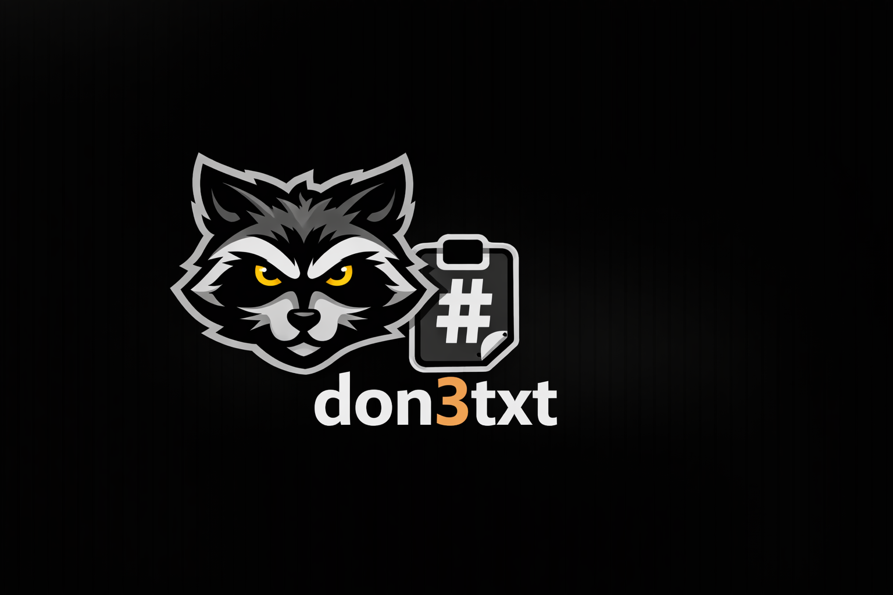

[](https://github.com/quiqueporta/don3txt/actions/workflows/tests.yml)

https://quiqueporta.com/don3txt/

A task manager for **Android** and **Linux** based on the [todo.txt](http://todotxt.org/) format, designed for users who prefer plain text, full data ownership, and simple workflows.

## Download

All downloads are on the [latest release](https://github.com/quiqueporta/don3txt/releases/latest).

### Android

Download the `.apk` file and install it on your device.

### Linux

- **AppImage** (recommended): download `don3txt-vX.Y.Z-x86_64.AppImage`, make it executable and run it:

  ```bash
  chmod +x don3txt-*-x86_64.AppImage
  ./don3txt-*-x86_64.AppImage
  ```

  The first time it asks whether to add don3txt to your applications menu. You can remove the menu entry later with `./don3txt-*-x86_64.AppImage --remove-desktop-entry`. If you manage AppImages with [Gear Lever](https://flathub.org/apps/it.mijorus.gearlever) or AppImageLauncher, the AppImage leaves the menu entry to them.

- **Tarball**: extract `don3txt-vX.Y.Z-linux-x86_64.tar.gz` wherever you want to keep the app and run `./install.sh` inside it to add it to your applications menu (`./uninstall.sh` removes it).

Choosing a folder in Settings uses `zenity`, which most desktops already include.

## Features

### Task management

- **Create tasks** with automatic parsing of projects (`+name`), contexts (`@name`) and metadata (`key:value`)
- **Complete/uncomplete** tasks with a single tap. The completion date is assigned automatically. A snackbar with **Undo** appears after completing a task
- **Delete tasks** from the three-dot menu on each task, with a snackbar and **Undo** to restore
- **Archive completed tasks** to `done.txt` in the same directory as the active `todo.txt`
- **Pull-to-refresh** to reload tasks from disk by swiping down
- **Priorities** from `(A)` to `(Z)` following the todo.txt standard
- **Creation dates** assigned automatically when a task is created
- **Due dates** (`due:YYYY-MM-DD`) with a built-in calendar picker
- **Threshold dates** (`t:YYYY-MM-DD`) with a calendar picker — tasks with a future threshold date are hidden from action views (Today, Inbox) but remain visible in Upcoming and Recurring
- **Visual tag pickers** for projects (`+name`) and contexts (`@name`) — tap `+` or `@` in the editor to browse existing tags as selectable chips, or create new ones. Compatible with manual typing: tags entered in the text field merge with those selected via UI without duplicates

### Recurring tasks

- **Flexible recurrence**: the next date is calculated from the completion date (e.g. `rec:2w`)
- **Strict recurrence**: the next date is calculated from the original threshold date (`t:`) (e.g. `rec:+2w`). If there is no `t:`, it falls back to flexible recurrence
- Supported units: days (`d`), weeks (`w`), months (`m`), years (`y`)
- Visual picker to configure recurrence when creating a task
- When a recurring task is completed, the next occurrence is created automatically with the new date

### Views and filters

- **Inbox**: shows all pending tasks
- **Past**: shows tasks whose reference date is before today, with a red count badge in the sidebar
- **Today** (default view): shows tasks whose reference date is today, with a count badge in the sidebar. The reference date is `due:`, or `t:` when there is no `due:`
- **Upcoming**: shows tasks due from tomorrow up to N days ahead, with a count badge and period indicator (e.g. "Upcoming · 7d"). The period is configurable in settings (3, 7, 14 or 30 days)
- **My Projects**: filters by project (`+name`), generated dynamically from pending tasks. Collapsible section in sidebar
- **My Contexts**: filters by context (`@name`), generated dynamically from pending tasks. Collapsible section in sidebar
- **Recurring**: shows all recurring tasks (with `rec:`), including those with a future threshold date
- **Completed**: shows all completed tasks sorted by completion date (newest first)
- **Search**: free-text search across tasks in any view, accessible from the AppBar search icon

### File management

- Works with standard plain-text `todo.txt` files
- **Select an existing file** from any location on the device
- **Create a new file** in a custom location
- **Restore** to the default file at any time
- Compatible with synchronisation tools such as **Syncthing**, **Dropbox**, etc.

### Using the same file on several devices

don3txt is designed to share `todo.txt` between your phone and your computer through a synchronisation tool:

- Every change rereads the file just before saving, so tasks added or changed on another device are never overwritten
- The list refreshes on its own when the file changes on disk and when the app returns to the foreground
- If a task you act on was changed on another device in the meantime, nothing is overwritten and the app tells you so
- Files are saved atomically, so the synchronisation tool never picks up a half-written `todo.txt`

If both devices change the file while they cannot see each other (for example, one of them offline), your synchronisation tool decides what to do. Syncthing, for instance, keeps one version and saves the other as `todo.sync-conflict-….txt` in the same folder.

### Settings

- **Theme**: System (default), Light or Dark — Material Design 3
- **First day of the week**: Monday or Sunday (affects the date picker)
- **Upcoming days**: period for the Upcoming view (3, 7, 14 or 30 days)
- **todo.txt file path**: configurable from settings

## todo.txt format

The app follows the [todo.txt standard](http://todotxt.org/). Examples:

```
Call Mom
(A) Call Mom
(A) 2011-03-02 Call Mom +Family @phone
x 2011-03-03 2011-03-01 Review PR +Project @github
Buy milk due:2024-01-15
Pay rent due:2024-02-01 rec:1m
Review report due:2024-03-01 t:2024-02-25 rec:+1m
```

| Component | Format | Example |
|---|---|---|
| Completion | `x` at the start | `x 2024-01-16 ...` |
| Priority | `(A)` to `(Z)` | `(A) Urgent task` |
| Creation date | `YYYY-MM-DD` | `2024-01-15 Task` |
| Project | `+name` | `+Family` |
| Context | `@name` | `@phone` |
| Due date | `due:YYYY-MM-DD` | `due:2024-01-20` |
| Threshold date | `t:YYYY-MM-DD` | `t:2024-01-18` |
| Recurrence | `rec:[+]Nu` | `rec:2w`, `rec:+1m` |
| Generic metadata | `key:value` | `effort:high` |

## Requirements

- [Flutter](https://docs.flutter.dev/get-started/install) 3.47.7 (the exact version is set in `pubspec.yaml`)
- **Android**: Android SDK with platform 37 and Java 17
- **Linux**: `clang`, `cmake`, `ninja-build`, `pkg-config` and `libgtk-3-dev`

## Install dependencies

```bash
flutter pub get
```

## Tests

```bash
flutter test
```

## Build

### Debug (development)

```bash
flutter build apk --debug
```

The APK is generated at `build/app/outputs/flutter-apk/app-debug.apk`.

### Release

```bash
flutter build apk --release
```

The APK is generated at `build/app/outputs/flutter-apk/app-release.apk`.

### Linux

```bash
flutter build linux --release
linux/packaging/package.sh X.Y.Z
```

The app is generated at `build/linux/x64/release/bundle/`, and the AppImage and tarball at `build/linux/dist/`.

## Run on emulator or device

```bash
flutter run
```

## Install on a connected device

```bash
adb install -r build/app/outputs/flutter-apk/app-release.apk
```

Avoid `flutter install`: it uninstalls the previous version first, which deletes the app settings.

## Project structure

```
lib/
├── main.dart
├── domain/              # Value Objects, Aggregates, pure functions
├── infrastructure/      # Repository: file read/write
├── application/         # Reactive state (ChangeNotifier)
└── ui/                  # Theme, screens and widgets
```

